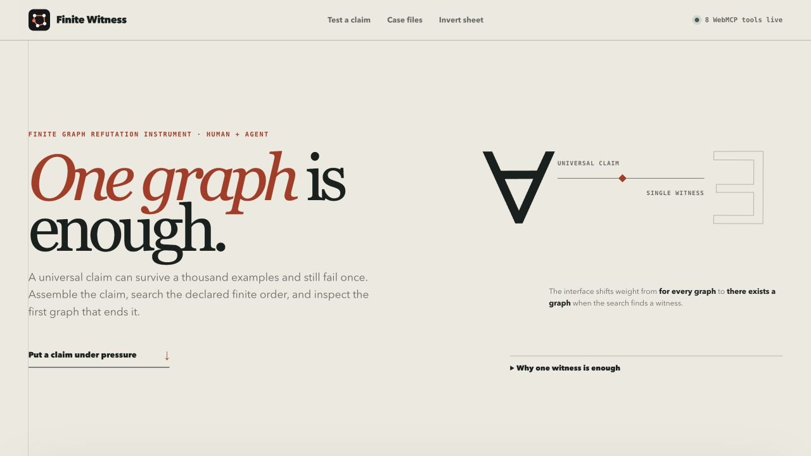

# Finite Witness

**One graph is enough to break a universal claim.**

Finite Witness is a browser app for testing conjectures about finite graphs, built for the [OpenAI WebMCP Challenge](https://webmcp.devpost.com/). You assemble a universal claim about simple graphs, an ordered search looks for a counterexample, and the first graph that breaks the claim replaces the universal statement on the page. The interface draws this as a move from `∀` to `∃`. An AI agent can do the same work through eight WebMCP tools: configure the claim, run the same search engine, save the witness, apply a repair and retrieve a deterministic certificate.

The agent handles structured search and bookkeeping. The person looks at the actual graph, checks its metrics and decides how the mathematical claim should change. Both work on the same live page, so the person sees every change the agent makes.

## Live app

[Open Finite Witness](https://chih-kai-wang.github.io/finite-witness-webmcp/)

The app needs no account, API key, build step or backend. Saved witnesses stay in the local storage of the browser you used.

## Interface concept



The layout follows the mathematical argument. At the start, the universal quantifier takes up most of the page. The ordered search line tightens as you add premises. When a counterexample appears, a single red `∃` takes over the consequence field. Candidate repairs then feed that witness back into the next universal statement. Every screen uses the same paper background, ruled lines, serif mathematics, black ink and a single red accent for the witness.

## Human and agent workflow

1. Assemble a finite simple graph conjecture and read the universal statement as it updates.
2. Search labeled graphs with at least three vertices in increasing order. The search stops at the first counterexample, and six vertices is the upper bound.
3. Inspect the first counterexample and its exact graph metrics.
4. Save the witness together with the claim and the search count.
5. Feed the witness into a candidate repair and test the revised statement right away.
6. Copy a deterministic counterexample certificate, or share the whole experiment as a URL.

## WebMCP implementation

The top-level page registers eight JavaScript WebMCP tools through `document.modelContext.registerTool`:

| Tool | Purpose |
| --- | --- |
| `get_workspace_state` | Read the visible claim, bound, latest result, and saved evidence count. |
| `load_demo_scenario` | Put a curated conjecture into the shared workbench. |
| `configure_conjecture` | Change any selected assumptions, conclusion, and search bound. |
| `search_counterexample` | Run the exhaustive engine and update the shared graph visualization. |
| `save_current_witness` | Persist the exact witness and search record in browser-local storage. |
| `suggest_conjecture_repairs` | Return stronger premises with machine-readable patches and the resulting next claims. |
| `apply_conjecture_repair` | Apply a repair in the visible workspace and optionally run the next exhaustive search. |
| `get_counterexample_certificate` | Return the claim, edge mask, edge list, metrics, enumeration order, and exact search counts. |

The registrations live in [`src/webmcp.js`](src/webmcp.js). Each tool handler calls the same application function as the matching control in the human interface, so there is no separate implementation for agents. Every result carries enough state for the agent to verify what changed on the visible page.

```js
await document.modelContext.registerTool({
  name: "search_counterexample",
  description: "Exhaustively search labeled finite simple graphs in increasing vertex order for the smallest counterexample to the visible conjecture.",
  inputSchema: {
    type: "object",
    properties: {},
    required: [],
    additionalProperties: false,
  },
  execute: async () => workspace.search("agent"),
});
```

The app checks for browser support before it registers anything, and it works normally in browsers without WebMCP. Tools are registered only in the top-level page, which matches the current ChatGPT in-app browser support described in the official [Site tools guide](https://learn.chatgpt.com/docs/webmcp).

## Search engine

Each graph is stored as an integer edge mask. For each vertex count, the engine checks the `2^(n choose 2)` labeled simple graphs in edge-mask order. It computes connectivity, the degree sequence, the triangle count, bipartiteness, the diameter, cycle structure and whether a perfect matching exists. The enumeration runs in a dedicated Web Worker so the page stays responsive.

The first admissible graph that violates the selected conclusion is returned as the witness with the fewest vertices. The app checks every earlier graph in the declared order and then stops at that witness. It reports the requested upper bound, the exact mask where it stopped, how many candidates it tested before stopping and how many of those were admissible. It does not claim that larger graphs were enumerated after the witness was found.

## Reproducibility and evidence

The [independent Python certificate checker](docs/CERTIFICATE_CHECKING.md) recomputes a witness from its edge list. Adding `--replay-search` also verifies that no earlier counterexample exists. Without that flag, the checker states explicitly that minimality was not checked.

Every witness the app finds gets a deterministic certificate ID. The certificate contains the normalized conjecture, the exact labeled edge mask and edge list, the graph metrics, the bounded enumeration order, the candidate count and the admissible-graph count. You can copy it from the visual workbench or read it through WebMCP.

“Copy experiment link” writes the normalized conjecture into the URL. Opening that link restores the same controls without a server or an account. Each saved witness includes its certificate, and you can export all saved witnesses together as a versioned JSON evidence bundle.

Changing any visible assumption clears the old result immediately. A witness for an earlier conjecture therefore cannot be shown or saved as evidence for a revised one.

## What it does not do

- Finite Witness is an educational tool for finite search. When a claim survives a bounded search, that is evidence for the claim, not a proof.
- The search covers graphs with three to six vertices only. It says nothing about larger graphs.
- The short certificate ID is a display label. It is not a signature and does not prove who produced the certificate.

## Run locally

You need Python 3 and a modern browser.

```bash
git clone https://github.com/Chih-Kai-Wang/finite-witness-webmcp.git
cd finite-witness-webmcp
python3 -m http.server 4173
```

Then open `http://127.0.0.1:4173`.

To inspect the WebMCP tools, use ChatGPT's in-app browser or enable WebMCP testing in a supported version of Google Chrome.

## Tests

The tests need Node.js 20 or newer.

```bash
npm test
```

They cover graph analysis, minimal counterexample results, applying repairs, round-trips of shareable experiments, configuration normalization and deterministic certificates.

## Privacy and safety

- The app has no analytics, tracking, cookies, network APIs or user accounts.
- No user data leaves the browser.
- Saved evidence lives in browser local storage, and clearing the site data removes it.
- WebMCP inputs are narrow and validated by JSON Schema.
- Tool outputs keep finite evidence separate from proof.

## AI assistance disclosure

OpenAI Codex was used during the hackathon period to help plan the product and to implement and review the HTML, CSS, JavaScript, tests, WebMCP registrations, documentation and submission materials. The entrant directed the project and is responsible for the submitted work. The running application uses no hosted model or AI API.

## License

[MIT](LICENSE) © 2026 f0909172434

## Deployment checks

Pull requests and pushes run the graph-engine and evidence tests. The Pages workflow deploys only after those tests pass on `main`, and it publishes only `index.html`, `styles.css`, `src/` and `assets/`.
